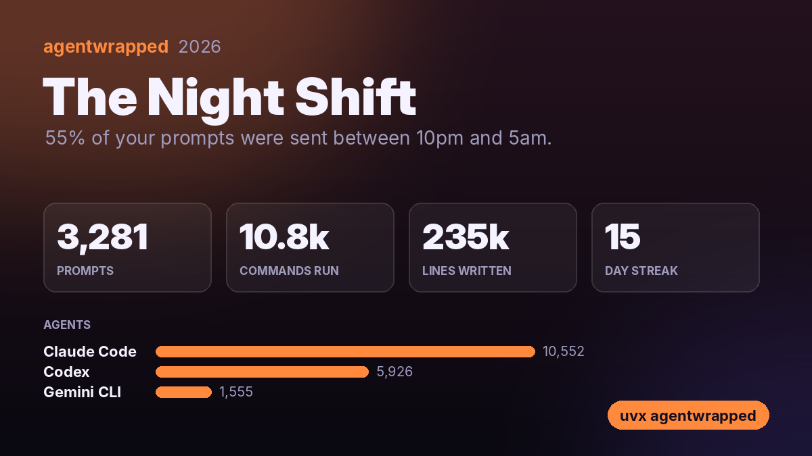

# agentwrapped

**Spotify Wrapped for your AI coding agents.** Your year with Claude Code, Codex and Gemini CLI: prompts sent, commands run, lines written, tokens burned, your longest session, how many times you told it "no", and your AI personality. Plus a share card.

```bash
uvx agentwrapped
```

<p align="center"></p>

<p align="center"></p>

<sub>Demo on a made-up year of agent logs generated by <a href="docs/demo.py">docs/demo.py</a>. Yours will be different.</sub>

## What's in it

- **Prompts, sessions and active days**, and your longest daily streak
- **Commands your agents ran** and what they ran most (`npm`, `git`, `pytest`…)
- **Lines of code they wrote**, across how many files
- **Which agents and models** did the work, and **tokens** where the logs record them
- **Your longest session**, counting only time you were actually going back and forth
- **When you prompt**: peak hour and day, share at night and on weekends
- **Manners**: thanks, pleases, and every "no", "undo", "revert" and "that's not what I meant"
- **Your AI personality**: The Night Shift, The Polite One, The Micromanager, The Delegator, The Architect, The Weekend Hacker or The Pair Programmer

The share card (`agentwrapped-<year>.png`, 1200×675, the size X and LinkedIn previews use) shows only numbers and agent names: no project names, prompts or code.

## Where it reads

| Agent | Logs |
|---|---|
| Claude Code | `~/.claude/projects/*/*.jsonl` (or `$CLAUDE_CONFIG_DIR`) |
| Codex CLI | `~/.codex/sessions/**/rollout-*.jsonl` (or `$CODEX_HOME`) |
| Gemini CLI | `~/.gemini/tmp/*/chats/session-*` |

Agents only keep logs for so long (Claude Code deletes transcripts after 30 days by default; set `cleanupPeriodDays` in its settings to keep more), so run it before year-end.

## Options

```
agentwrapped                 # this year, animated
agentwrapped --year 2025
agentwrapped --no-anim       # just the summary
agentwrapped --speed 2       # faster animation
agentwrapped --card me.png   # where to save the share card (or --no-card)
```

## Privacy

Everything stays on your machine. agentwrapped only reads the log files above.

## Install

```bash
uvx agentwrapped           # run without installing
pipx install agentwrapped  # or install it
```

Requires Python 3.9+. Depends on `rich`, `pillow` and `pyfiglet`. Card fonts: Inter (SIL Open Font License).

## License

MIT
